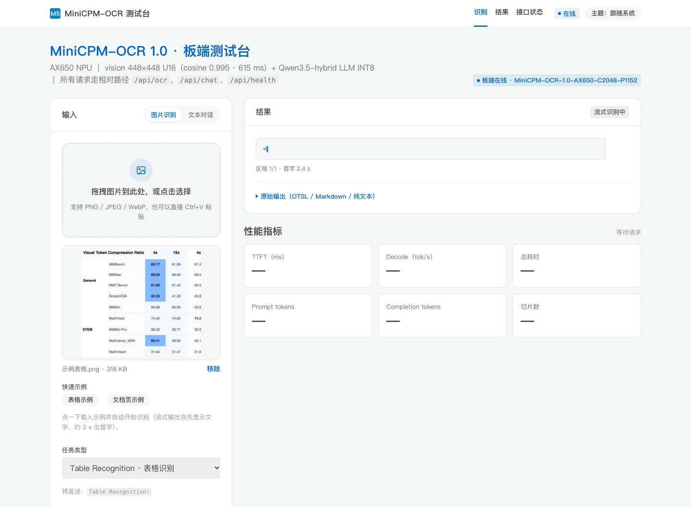
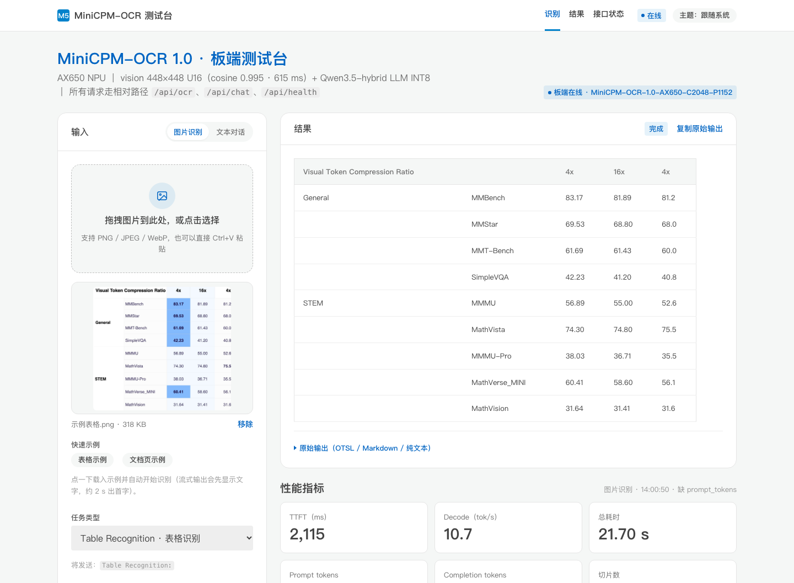
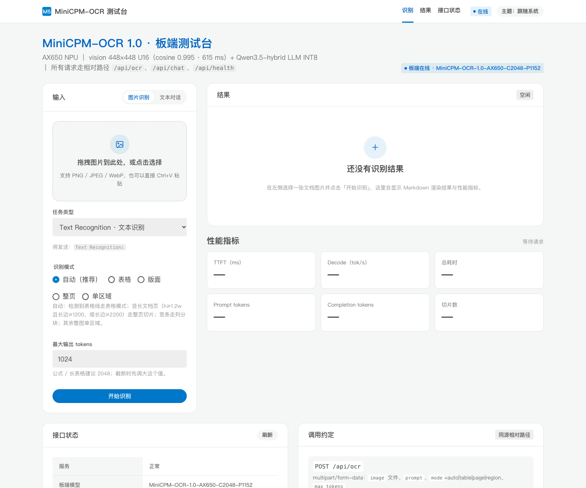

# MiniCPM-OCR 1.0 on AX8850

把 [MiniCPM-OCR 1.0](https://huggingface.co/openbmb/MiniCPM-OCR-1.0)（1.30 B 端到端 OCR 视觉语言模型）完整跑在
**AX8850 系列** NPU 上的转换流程 + 可运行模型包 + 板端网页测试台。

- **视觉编码器**：27 层 SigLIP 类塔 → 静态 ONNX → axmodel（**必须 U16**，INT8 会崩）
- **文本 LLM**：Qwen3.5 hybrid（24 层 = 18 线性注意力 + 6 full attention）→ `pulsar2 llm_build2` 逐层 axmodel
- **运行时**：AXERA `axllm`（OpenAI 兼容接口），prefill 桶 1152 / ctx 2048
- **应用侧**：MiniCPM-V 式切片（9 片 / 2276 token，与官方 processor 逐片一致）+ OTSL→Markdown + 浏览器测试台

## 命名约定（重要）

- 本项目对外统一称 **AX8850 系列**：两块部署板（192.168.10.144 / 192.168.10.105）都是 AX8850 系列，
  对应 AX650N / AX650C 板型（`/proc/ax_proc/chip_type` 仍显示 `AX650*`）。
- **编译目标保留 `AX650` 字样**：Pulsar2 的 `--chip AX650` / `target_hardware: AX650` 是工具链目标名；
  同一份 axmodel 在 AX8850 系列板上兼容运行（本仓库产物即如此）。
- 文档里出现 AX650 的地方均为「编译目标」或「板型代号」，产品口径以 AX8850 为准。

> ⚠️ 这是**社区转换产物**，不是 AXERA / OpenBMB 官方发布。模型仓：
> 🤗 [`yunyu1258/minicpm-ocr-1.0-ax650`](https://huggingface.co/yunyu1258/minicpm-ocr-1.0-ax650)（**37 文件 / 2730 MB**：U16 vision + 可选 U16 版面模型 + sha256 清单，Apache-2.0 / 内含 BSD-3 NOTICE）

---

## 识别模式（服务端，`/api/ocr`）

| mode | 行为 | 适用 |
|---|---|---|
| `auto`（默认） | 表格线检测→表格模式；竖长大图→整页切片；宽条→列分块；其余→单区域 | 一般上传首选 |
| `table` | **整表识别**：≤2048px 一次送；更大的表只按行切、按行合并 → 一个 Markdown 表格 | 表格截图/裁剪的表格区域 |
| `page` | 官方 9 片切片（默认跳过全局缩略片），逐片识别后拼接 | 整页文档（无版面模型，页内表格仍可能被切断） |
| `wide` | 宽条文字按列分块后顺序拼接 | 长条文本截图 |
| `layout` | **DocLayout-YOLO 版面检测**（U16 axmodel，212 ms）→ 按区域类型识别 → 阅读顺序拼接 | 整页文档（含混合版面） |
| `region` | 整图作单块识别 | 已裁好的单个区域 |

> 表格图请用 `auto`/`table`：用 `page` 会把表格沿列切成多条，输出乱序（已复现并记录在
> [docs/table-mode.md](docs/table-mode.md)）。整页混合版面用 `layout`（需版面 axmodel，见
> [docs/layout-mode.md](docs/layout-mode.md)）：DocLayout-YOLO 转 AX8850 的完整步骤、精度对拍与踩坑都在里面。

## 流式输出（逐字显示）

axllm 支持 OpenAI 兼容 `stream: true`（SSE），板端服务提供两个流式端点，网页默认开启：

- `POST /api/ocr_stream`（multipart）：`meta`（模式/块数）→ 每块 `part_start` → `delta*` → `part_done` → `done`（含 markdown/metrics）
- `POST /api/chat_stream`（json）：`meta` → `delta*` → `done`

| 场景 | 首字时间（TTFT） | 总耗时 |
|---|---|---|
| 表格示例（table 模式，233 token） | **2.1 s** | 21.7 s |
| 文本对话（32 token） | **0.56 s** | 2.8 s |
| 版面模式 PPT 页（6 区域） | 第 1 区 ~2.1 s，逐区出现 | 19.5 s |

网页还带「快速示例」按钮（表格 / 文档页），点一下载入同源示例图并自动开始识别。
流式失败会自动回退到非流式接口。细节：[docs/streaming.md](docs/streaming.md)




## 实测数字（最终版，AX8850 真板 [AX650N/AX650C 板型]，U16 vision）

| 场景 | 结果 |
|---|---|
| **视觉编码器**（448×448 → [1,256,1024]，511 MB） | **615 ms**，对 ONNX 参考 cosine **0.995322**（INT8 仅 0.311，图像不可用） |
| **单块表格 OCR**（504×392，277 prompt → 119 token） | **12.1 s**；对 HF 参考：字符相似度 **1.0**、数字准确率 **12/12** |
| 单块表格 OCR（448×448，277 → 237 token） | **21.9 s**，decode **11.6 tok/s**（板端日志 11.1–11.8） |
| **整页切片**（官方 9 片口径，跳过全局缩略片） | **147 s/页**，1515 completion token |
| TTFT（含视觉编码） | **2.09–2.15 s** |
| 文本 "1+1" / "一句话解释 OCR" | **0.6 s** / **1.9 s（≈15.3 tok/s）** |
| 切片对齐官方 processor | **9 片 / 2276 image token**，逐片尺寸/网格/token 完全一致（差 0 px） |
| 模型包 / CMM 占用 | 2.5 GB / 加载后 CMM 剩余 **2130 MB** |
| 并发（axllm 单并发） | 文本 0.55 req/s（1.82 s）；OCR 0.082 req/s（12.2 s/块），并发请求排队 |
| OmniDocBench（12 页分层抽样） | page（网格切片）TextEdit **73.46**；oracle（GT 版面）**47.42** |

细节：[docs/performance.md](docs/performance.md)、[docs/accuracy.md](docs/accuracy.md)、[docs/omnidocbench.md](docs/omnidocbench.md)。

> **关键结论**：视觉编码器必须 **U16 激活**，且全量 27 层只能用 **Pulsar2 6.0** 编译——
> 7.0 / 8.0 都会在 `build op serially` 阶段原生崩溃（`new_ddr_tensor` 后进程被杀），6.0 可稳定编出 511 MB axmodel。

---

## 上手：三步

### 1. 下模型包（HF）

```bash
export HF_ENDPOINT=https://hf-mirror.com   # 国内
huggingface-cli download yunyu1258/minicpm-ocr-1.0-ax650 \
  --local-dir ./axllm_pkg --local-dir-use-symlinks False
```

期望得到 **26 个 `.axmodel`**（24 层 + post + vision）、embed bin、tokenizer txt、`config.json`、`bin/axllm`。
文件清单与校验方式见 [models/README.md](models/README.md)。

### 2. 传到板子并启动

```bash
# 转换机 / Mac 上（需要能 ssh 到板子）：tar over ssh，板端没有 rsync
./scripts/deploy_to_board.sh \
  --pkg ./axllm_pkg --host root@192.168.10.144 \
  --dst /root/minicpm-ocr-v2 --port 18081
# 想同时用网页测试台：把本仓库 service/ 一起拷到模型包目录下（或直接在板上 git clone 本仓库）
```

板端手工启动（与脚本等价）：

```bash
cd /root/minicpm-ocr-v2
chmod +x bin/axllm
setsid env LD_LIBRARY_PATH=/opt/lib:/opt/bin:$PWD/bin \
  ./bin/axllm serve . --port 18081 > serve.log 2>&1 < /dev/null &

# 自检：应返回 model id = MiniCPM-OCR-1.0-AX650-C2048-P1152
curl -s http://127.0.0.1:18081/v1/models | head -c 300
```

### 3. 浏览器访问

```bash
cd /root/minicpm-ocr-v2
./service/start.sh start          # axllm(18081) + Flask 测试台(8080) 一起起
./service/start.sh status
```

打开 **`http://<板子 IP>:8080/`**：上传图片 → 选任务词（Text / Table / Formula / Seal / Chart）
→ 整页或单区域 → 看 Markdown 结果 + TTFT / decode / 切片指标。



> 截图来自板端 `http://<board>:8080/` 的真实页面（空态）；填入图片后「性能指标」区会显示实测 TTFT / decode tok/s / 片数等。

接口（不走网页也能用）：

```bash
# 单块图像
curl -s http://<board-ip>:18081/v1/chat/completions -H 'Content-Type: application/json' -d '{
  "model": "MiniCPM-OCR-1.0-AX650-C2048-P1152",
  "messages": [{"role":"user","content":[
    {"type":"text","text":"Table Recognition:"},
    {"type":"image_url","image_url":{"url":"data:image/png;base64,...."}}]}],
  "max_tokens": 768, "temperature": 0.0}'
```

---

## 目录

```
minicpm-ocr-ax650/
├── README.md                  # 本文件
├── docs/
│   ├── conversion.md          # HF → 纯文本 LLM → llm_build2 → vision ONNX → U16 axmodel → 组装（含踩坑）
│   ├── deployment.md          # 板端部署：tar 传输、axllm 配置、端口、CMM、服务化
│   ├── accuracy.md            # 精度：vision cosine 表、U16 结论、切片 2276 token、tokenizer
│   ├── performance.md         # 实测性能：TTFT / decode / 内存 / 与 CPU 基线对比
│   └── troubleshooting.md     # 已知问题：INT8 崩、prefill 桶、CMM、pkill 自杀…
├── scripts/
│   ├── prep_text_model.py     # 权重改名 model.language_model.* → model.* + config 重标 qwen3_5
│   ├── build_llm.sh           # llm_build2（s8/bf16, prefill 1152, ctx 2048）
│   ├── export_vision_onnx.py  # HF → vision_448_merged.onnx（NaViT 打包，1×3×14×14336 → 1×256×1024）
│   ├── build_vision.py        # pulsar2 build vision（官方 U16 配置 + 64 张真实校准）
│   ├── assemble_package.py    # 组装 axllm 模型包（config.json / 24 层 / embed / post / vision / bin）
│   ├── deploy_to_board.sh     # tar over ssh 传包 + 板端拉起 + 就绪检查
│   └── compare_ocr_output.py  # 板端 vs 参考输出的字符相似度 / 表格 cell F1 / 数字准确率
├── service/
│   ├── start.sh               # 板端一键起停（axllm 18081 + Flask 8080）
│   ├── board_app.py           # Flask：/api/ocr(page|region)、/api/chat、/api/health、/api/slices
│   ├── slicing.py             # 官方切片逻辑复刻（纯 numpy+PIL，与 processor 逐片对齐）
│   ├── otsl_to_md.py          # OTSL → Markdown/HTML（板端渲染表格）
│   ├── samples/               # 真实模型输出样例（otsl 单元测试用）
│   └── web/                   # M5Stack 风格静态前端（零依赖、无构建）
└── models/README.md           # HF 模型包文件清单 / 校验 / 许可
```

---

## 进阶：从零转换

不想用打包好的模型、想自己转一遍：看 **[docs/conversion.md](docs/conversion.md)**，最短路径是

```bash
# 1) 下载 HF 原始权重（ModelScope 直连更快）
# 2) 拆纯文本 LLM + config 重标
python3 scripts/prep_text_model.py --src origin --out origin_text
# 3) 24 层文本 LLM
INPUT=origin_text OUT_DIR=llm_v2 bash scripts/build_llm.sh
# 4) vision 静态 ONNX
python3 scripts/export_vision_onnx.py --model-dir origin --out-dir .
# 5) vision axmodel（U16！）
python3 scripts/build_vision.py --onnx vision_448_merged.onnx --calib calib/pixel_values.tar.gz \
    --out-dir vision_task
# 6) 组装 + 推板
python3 scripts/assemble_package.py --work-dir . --dest axllm_pkg \
    --tokenizer minicpm_ocr_tokenizer.txt --axllm-bin /path/to/axllm --ctx 2048
./scripts/deploy_to_board.sh --pkg axllm_pkg --host root@<board> --port 18081
```

**硬前置**：编译必须在 **Linux x86_64** 上做（Pulsar2 只发 Linux x86_64 独立包，macOS 最多导 ONNX）；
LLM 用 Pulsar2 8.0（`llm_build2`）；**vision 必须 U16 且必须用 Pulsar2 6.0**；tokenizer.txt 用 transformers 5.22 生成。

---

## 已知限制

1. **vision 固定 448×448 单块**（每块 256 image token）。整页靠应用侧切片；板端**没有**官方 SDK 的 PP-DocLayoutV3 版面模型（该模型是 DETR+GridSample，不适合 AX8850，见 [docs/layout-model-feasibility.md](docs/layout-model-feasibility.md)）。实测版面信息对 OmniDocBench TextEdit 有约 26 点收益，后续可换 DocLayout-YOLO。
2. `max_context=2048`：整页 9 片（含全局缩略）= 2276 image token，页服务已默认**跳过全局缩略片**（8 片 = 2016 token），避免贴边。
3. decode ≈11.6 tok/s 是当前瓶颈（237 token 输出 ≈20 s）；DSpark 解码加速未覆盖。
4. `vlm_type` 复用官方 `MiniCPMV46VL` profile；本模型 4x 压缩（256 token/块）与官方 16x（64 token/块）不同，token 数按本模型实际写入。
5. 训练/微调、PDF 多页批处理未包含。
6. `slice_times` 单位已统一为毫秒（`metrics.slice_time_unit="ms"`）。

---

## 交付状态

| 项 | 状态 |
|---|---|
| U16 vision axmodel | ✅ 511 MB / 615 ms / cosine **0.995322**，已部署板端并上线 HF |
| 表格模式（auto/table/wide） | ✅ 修复表格被整页切片切碎乱序的问题（[docs/table-mode.md](docs/table-mode.md)） |
| 版面模式（DocLayout-YOLO U16） | ✅ 35 MB / 212 ms，boxes cos 0.999999 / logits 0.99995，板端已上线（[docs/layout-mode.md](docs/layout-mode.md)） |
| 第二台设备（AX8850C） | ✅ 192.168.10.105:8088 已部署并实测（表格 23.2 s / 版面 21.2 s / 流式首字 0.37 s），见 [docs/deploy-105.md](docs/deploy-105.md) |
| 板端服务 + M5Stack 网页 | ✅ `auto/table/layout/page/wide/region` 六种模式，`/api/health` 返回 `layout_model` |
| 模型仓 | ✅ [`yunyu1258/minicpm-ocr-1.0-ax650`](https://huggingface.co/yunyu1258/minicpm-ocr-1.0-ax650)：37 文件 / 2730 MB，含 `sha256sum.txt` |
| 端到端精度 | ✅ 单块表格 字符相似度 1.0、数字 12/12；OmniDocBench 12 页 page/oracle 两口径（[docs/omnidocbench.md](docs/omnidocbench.md)） |
| 性能/并发 | ✅ 图像块 12.1–21.9 s（decode 11.6 tok/s）、整页 page 147 s、版面 19.8 s（PPT 页）；并发数据见 [docs/performance.md](docs/performance.md) |
| LICENSE / NOTICE | ✅ Apache-2.0（代码）+ NOTICE 列明 axllm BSD-3 / MiniCPM-OCR / DocLayout-YOLO |

可选增强（未做，不影响交付）：
- 板端开机自启（systemd）与 Flask 上传体积上限；
- OCR 并发 >1 的排队/批处理策略（axllm 最大并发 1）；
- `FLOAT_MATMUL_USE_CONV_EU=1` 与官方 llm_build 的逐位对齐（现有包实测正常，未做差异消融）；
- OmniDocBench 全量 1651 页批量评测（当前 12 页抽样）。

---

## 致谢

- 模型：[OpenBMB / MiniCPM-OCR](https://github.com/OpenBMB/MiniCPM-OCR)（Apache-2.0）
- 工具链：[AXERA-TECH Pulsar2](https://huggingface.co/AXERA-TECH) 与 [ax-llm](https://github.com/AXERA-TECH/ax-llm)（BSD-3-Clause）
- 视觉转换配置参考：[AXERA-TECH/MiniCPM-V-4.6.axera](https://github.com/AXERA-TECH/MiniCPM-V-4.6.axera)
- 转换流程编排：[AXERA-TECH/Magnetar](https://github.com/AXERA-TECH/Magnetar)


---

## AX8860 前瞻（估算，待上市实测）

下一代 AX8860（6nm / 256 TOPS / LPDDR5X）的公开规格与我们对本模型的带宽建模估算：

| 平台 | 带宽 | decode 估算 | 单块 OCR（233 token） | TTFT |
|---|---|---|---|---|
| AX8850（实测） | ≈34 GB/s | 11.6 tok/s | 22 s | 2.1 s |
| **AX8860** | 136 GB/s | **≈45 tok/s** | **≈5–6 s** | ≈0.5 s |
| **AX8860P** | 273 GB/s | **≈90 tok/s** | **≈3 s** | ≈0.4 s |
| AX8860 + INT4/FP4 权重 | 136 GB/s | ≈85–95 tok/s | ≈2.5 s | ≈0.5 s |

完整推导（每 token 1.6 GB 权重、55% 带宽利用率、prefill/vision 估算、64–128 GB 内存能跑多大模型、
AX8860 上市后如何重编验证）见 [docs/ax8860-outlook.md](docs/ax8860-outlook.md)。

## OmniDocBench 评测（2026-11-11）

见 [docs/omnidocbench.md](docs/omnidocbench.md)。摘要（12 页分层抽样）：

| 模式 | 平均文本编辑距离 | 平均耗时 |
|---|---|---|
| page（网格切片 + 统一 prompt，现状） | **0.7346（TextEdit 73.46）** | 91.8 s/页 |
| oracle（GT 版面框 + 按类型 prompt，上限） | 见文档（运行中） | — |

并发：文本并发 1 → 0.55 req/s（1.82 s）；OCR 并发 1 → 0.082 req/s（12.2 s/块）；axllm 单并发，请求排队。
官方 1.2 pages/s 是 vLLM/L40S 口径，端侧 AX8850 差 2~3 个数量级属预期。
